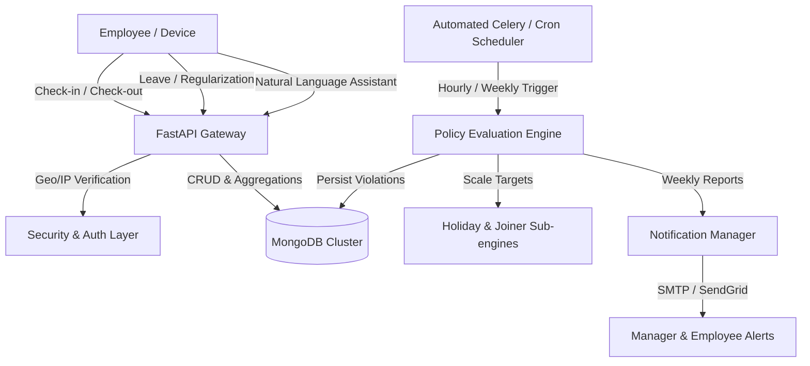
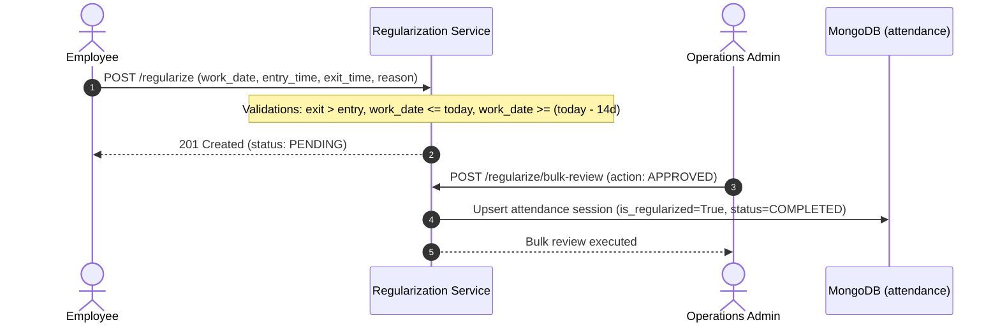
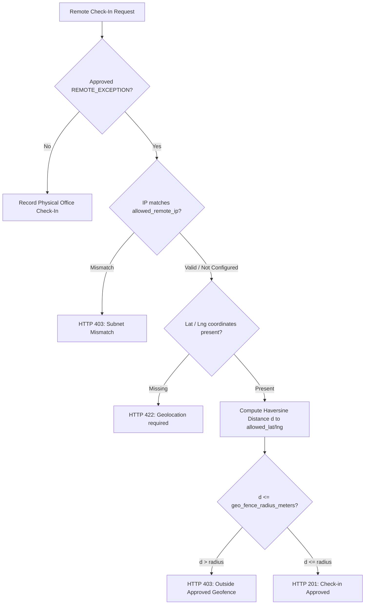
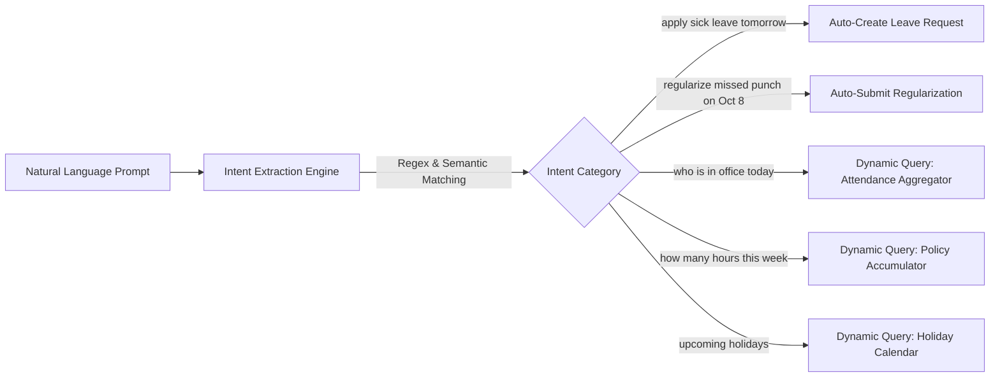
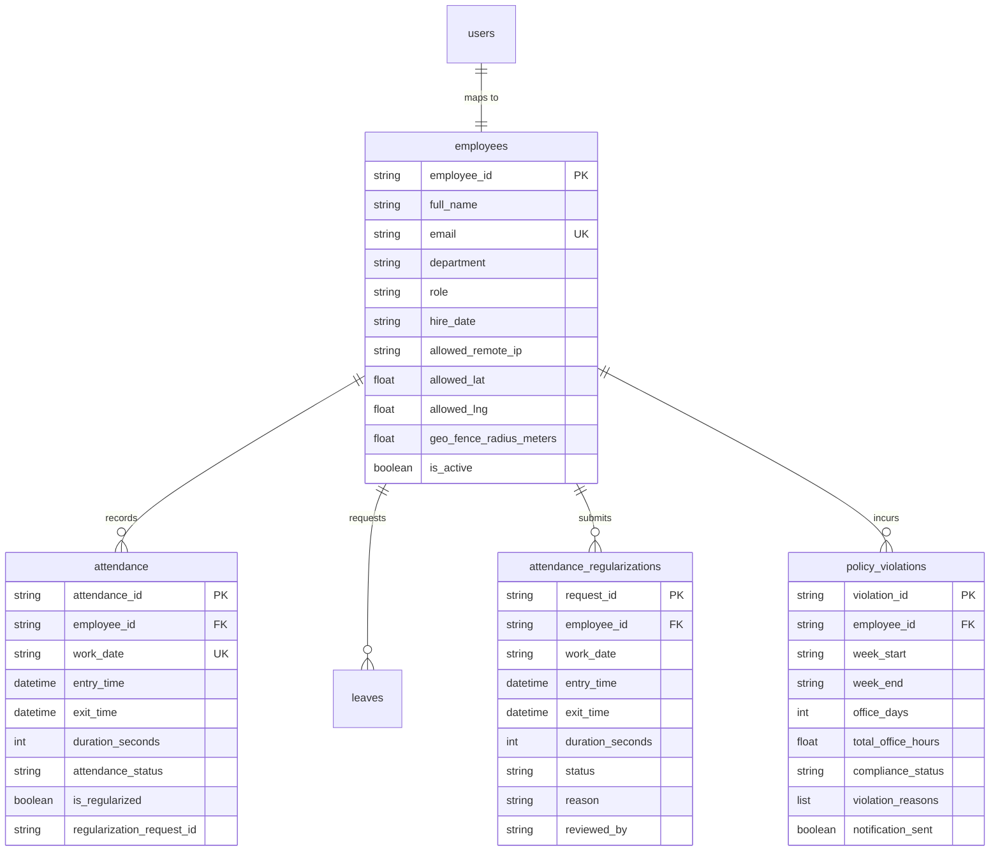
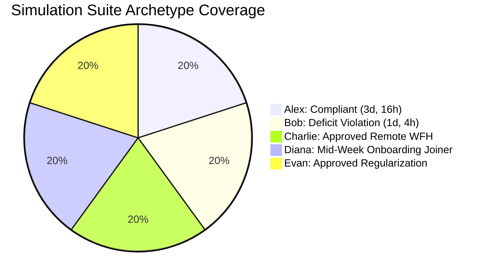

# Central Attendance Management System (CAMS)
## Enterprise Architecture, Governance, & System Design Specification

---

## 1. PROJECT OVERVIEW & GOVERNANCE

### 1.1 Purpose of the System
The **Central Attendance Management System (CAMS)** is an enterprise-grade platform developed to reconcile physical workspace occupancy with modern hybrid/remote work policies. Modern enterprise operations require unambiguous visibility into worker presence while honoring flexible work accommodations, paid leaves, and regulatory labor standards.

CAMS centralizes and automates:
* **Real-time Workplace Presence**: Tamper-proof, server-controlled check-in and check-out tracking eliminating client-side clock alterations.
* **Hybrid Work-from-Home (WFH) Governance**: Algorithmic evaluation of weekly office attendance requirements with dynamic policy scaling.
* **Autonomous Exemption Management**: End-to-end lifecycle for formal leaves (`VACATION`, `SICK`, `CASUAL`) and authorized remote work exceptions (`REMOTE_EXCEPTION`).
* **Continuous Compliance Auditing**: Proactive rolling-window health monitoring, automated violation logging, and notification dispatching.



### 1.2 Core Compliance Rules & Floor Time Constraints
Enterprise policy mandates that all active non-exempt employees meet two simultaneous weekly compliance thresholds during a standard evaluation cycle (Monday `00:00:00` to Sunday `23:59:59` company local time):

1. **3-Day Minimum Weekly Office Attendance (`POLICY_REQUIRED_DAYS = 3`)**:
   * An employee must establish physical office presence on at least 3 distinct calendar workdays within the Monday-to-Sunday window.
   * Multiple check-ins on the same workday aggregate into one distinct attended workday.
2. **15-Hour Floor Time Threshold (`POLICY_REQUIRED_HOURS = 15.0`)**:
   * An employee must accumulate a minimum of 15.0 net hours of verified office presence across the calendar week.
   * Average floor time constraint: $\frac{15.0\text{ hours}}{3\text{ days}} = 5.0\text{ hours/day}$.
3. **Simultaneous Constraint Enforcement**:
   * Both conditions are evaluated conjunctively:
   $$\text{Compliant} \iff (\text{Office Days} \ge \text{Adjusted Required Days}) \land (\text{Total Office Hours} \ge \text{Adjusted Required Hours})$$
   * Failing either condition flags the weekly evaluation as `NON_COMPLIANT`.
   * While the evaluation week is active (current Monday through Sunday), non-qualifying records carry a status of `PENDING` rather than immediate violation to allow employees the remaining days to fulfill targets.

---

## 2. CORE FEATURES & LOGICAL MECHANICS

### 2.1 Attendance Regularization: 14-Day Ceiling & Future-Date Blocks
Employees who miss physical check-ins due to hardware failures, badge issues, or off-site meetings can submit a formal regularization request (`attendance_regularizations`).



#### Guardrail Mechanics:
1. **Future-Date Blocking**:
   * Any request where `work_date > today` is rejected immediately with HTTP `422 Unprocessable Entity`:
     ```python
     if req_date > today:
         raise HTTPException(
             status_code=422,
             detail="Cannot regularize attendance for future dates"
         )
     ```
2. **14-Day Rolling Policy Ceiling**:
   * Requests cannot be submitted for workdays older than 14 rolling calendar days prior to the current date (`earliest_allowed = today - timedelta(days=14)`).
   * Requests submitted beyond this window trigger HTTP `422 Unprocessable Entity`:
     $$\text{Submission Allowed} \iff \text{today} - 14\text{ days} \le \text{work\_date} \le \text{today}$$
3. **Approval Lifecycle & Attendance Synchronization**:
   * When an Admin approves a regularization (`RegularizationStatus.APPROVED`), the system performs an atomic upsert into `attendance`:
     * Sets `entry_time`, `exit_time`, and calculated `duration_seconds`.
     * Marks `attendance_status = "COMPLETED"`.
     * Flags `is_regularized = True` and links `regularization_request_id`.
     * Instantly makes the regularized duration count toward weekly compliance calculations.

---

### 2.2 Leave & Remote Exemption Lifecycle
CAMS provides four distinct absence pipelines under the `leaves` entity:

| Leave Type | Purpose & Impact | Impact on Target Scaling |
| :--- | :--- | :--- |
| `VACATION` | Planned annual leave | Reduces required days by 1; reduces required hours by 5.0h per approved workday |
| `SICK` | Health & medical incapacitation | Reduces required days by 1; reduces required hours by 5.0h per approved workday |
| `CASUAL` | Urgent personal affairs | Reduces required days by 1; reduces required hours by 5.0h per approved workday |
| `REMOTE_EXCEPTION` | Approved work-from-home or field work | Unlocks remote clock-in with IP subnet & Geofence validation; counts toward compliance |

#### Overlapping Leave Guardrail:
To prevent duplicate deductions or concurrent exemptions, new leave submissions are validated against approved and pending requests:
```python
overlap = await db.leaves.find_one({
    "employee_id": employee_id,
    "status": {"$in": ["PENDING", "APPROVED"]},
    "start_date": {"$lte": request_in.end_date},
    "end_date": {"$gte": request_in.start_date},
})
if overlap:
    raise HTTPException(status_code=409, detail="Leave request conflicts with existing leave")
```

---

### 2.3 Pro-Rata Mid-Week Joiner Math
When an employee joins the company mid-week (`hire_date`), holding them to the standard 3-day/15-hour target would produce an unearned violation. CAMS dynamically computes pre-hire business days:

```python
def compute_pre_hire_workdays(hire_date: date, week_start: date, week_end: date) -> int:
    if hire_date <= week_start:
        return 0
    if hire_date > week_end:
        return 5  # Joined after week ended
    curr = week_start
    pre_hire = 0
    while curr < hire_date:
        if curr.weekday() < 5:  # Monday to Friday business days
            pre_hire += 1
        curr += timedelta(days=1)
    return pre_hire
```

#### Mathematical Target Reduction Formula:
Let:
* $B_d = 3$ (Base required days)
* $B_h = 15.0$ (Base required hours)
* $D_{\text{target}} = \frac{B_h}{B_d} = 5.0\text{ hours/day}$
* $L = \text{Approved Leave Days}$
* $H = \text{Company Holiday Days}$
* $P = \text{Pre-hire Business Days}$
* $E_{\text{total}} = L + H + P$ (Total exempt days)

$$\text{Adjusted Required Days } (R_d) = \max(0, B_d - E_{\text{total}})$$
$$\text{Adjusted Required Hours } (R_h) = \max(0.0, R_d \times D_{\text{target}})$$

#### Example (Joiner on Thursday):
* `week_start` = Monday Sept 14; `hire_date` = Thursday Sept 17.
* Pre-hire business days: Mon, Tue, Wed $\implies P = 3$.
* $E_{\text{total}} = 0 + 0 + 3 = 3$.
* $R_d = \max(0, 3 - 3) = 0\text{ days}$.
* $R_h = 0.0\text{ hours}$.
* Status: Automatically flagged as `EXEMPT` (or `COMPLIANT` if they attended Thursday or Friday).

---

### 2.4 Holiday Calendar Sync & Target Reductions
The Holiday Engine (`HolidayService`) reconciles company-wide observed holidays (`holidays` collection) against weekly evaluation windows.

* **Exemption Attribution**: If a recognized holiday falls on a Monday through Friday, it adds $+1$ to `holidays_count` ($H$).
* **Proportional Target Dampening**:
  * 1 Holiday in a week: Required days scale from $3 \rightarrow 2$ days; Required hours scale from $15.0 \rightarrow 10.0$ hours.
  * 2 Holidays in a week: Required days scale from $3 \rightarrow 1$ day; Required hours scale from $15.0 \rightarrow 5.0$ hours.
  * 3 Holidays in a week: Required days scale to $0$ days; Required hours scale to $0.0$ hours $\implies$ Entire workforce marked `EXEMPT`.

---

## 3. SECURITY & INTELLIGENCE ARCHITECTURE

### 3.1 Geofencing & Subnet Binding (Haversine Distance Engine)
For employees operating under an approved `REMOTE_EXCEPTION`, physical office gates are bypassed in favor of cryptographically validated location telemetry.



#### The Haversine Great-Circle Formula:
The distance between the employee's browser device and their pre-registered telework residence is computed via spherical trigonometry:

$$a = \sin^2\left(\frac{\Delta \phi}{2}\right) + \cos(\phi_1)\cos(\phi_2)\sin^2\left(\frac{\Delta \lambda}{2}\right)$$
$$c = 2 \cdot \text{atan2}\left(\sqrt{a}, \sqrt{1-a}\right)$$
$$d = R \cdot c \quad (\text{where } R = 6,371,000\text{ meters})$$

* If $d > \text{geo\_fence\_radius\_meters}$ (default: $500.0\text{ m}$), the clock-in request is rejected with HTTP `403 Forbidden`.

---

### 3.2 Natural Language Assistant Actions
The integrated AI Assistant (`AssistantService`) translates plain English prompts from the top Navbar, left Sidebar, or floating HUD into deterministic system actions:



#### Supported Intent Mappings:
1. **Leave Creation Intent (`ACTION_CREATE_LEAVE`)**:
   * *Sample Input*: `"Apply sick leave tomorrow because flu"`
   * *Parsing*: Extracts date tokens (`tomorrow` $\rightarrow$ calculated ISO date), categorizes leave type (`sick` $\rightarrow$ `LeaveType.SICK`), and invokes `LeaveService.create_leave_request`.
2. **Attendance Regularization Intent (`ACTION_REGULARIZE`)**:
   * *Sample Input*: `"Regularize attendance for 2026-10-08 from 09:00 to 17:00"`
   * *Parsing*: Normalizes date and time bounds, confirms 14-day window ceiling, and invokes `RegularizationService.create_request`.
3. **Compliance & Hour Status (`STATUS_HOURS`)**:
   * *Sample Input*: `"Am I compliant this week?"`
   * *Parsing*: Fetches real-time accumulated hours and attended days against adjusted targets.

---

### 3.3 JWT Session Lifecycles & Silent Renewal Interceptor
Authentication enforces stateless JWT tokens with asymmetric protection and seamless client renewal:

* **Access Token**: Short-lived (30 minutes), carrying `user_id`, `role`, and `employee_id`.
* **Refresh Token**: Long-lived (7 days), stored in secure local storage.
* **Axios Interceptor**: Intercepts HTTP `401 Unauthorized` responses without crashing the UI, queues concurrent failed requests, exchanges the refresh token at `/api/v1/auth/refresh-token`, updates HTTP headers, and retries the original requests automatically.

---

## 4. SYSTEM DESIGN, DATA SCHEMA, & BACKEND APIS

### 4.1 MongoDB Schema Architecture



#### Representation of Missing Logs ("Not attended office"):
When an employee does not check in on a given workday:
1. No raw document is written during the day, maintaining sparse storage efficiency.
2. In API lookups (`GET /api/v1/attendance/today` or calendar mapping grids), the system returns a synthetic placeholder:
   ```json
   {
     "attendance_id": "",
     "employee_id": "EMP001",
     "work_date": "2026-10-10",
     "entry_time": null,
     "exit_time": null,
     "duration_seconds": 0,
     "duration_hours": 0.0,
     "attendance_status": "NOT_ATTENDED"
   }
   ```
3. Frontend UI components transform `NOT_ATTENDED` into a slate badge labeled `"Not attended office"`.

#### String Timestamp Formatting Engine:
Timestamps are stored in MongoDB as ISO-8601 UTC date objects (`datetime(..., tzinfo=UTC)`). The centralized presentation layer maps raw timestamps to executive corporate strings:
* Example: `2026-10-09T12:56:56Z` $\rightarrow$ `"October 9, 2026 6:26:56 PM IST"` (derived via `to_company_tz()` using `Asia/Kolkata`).

---

### 4.2 Comprehensive API Endpoint Reference

#### 1. POST `/api/v1/attendance/check-in`
* **Purpose**: Records employee office entry. Server generates UTC timestamp to eliminate manipulation.
* **Request Body**:
  ```json
  {
    "employee_id": "EMP001",
    "client_ip": "198.51.100.50",
    "latitude": 12.9716,
    "longitude": 77.5946
  }
  ```
* **Response (HTTP 201)**:
  ```json
  {
    "message": "Check-in recorded successfully",
    "attendance": {
      "attendance_id": "8b9e6f2a-7140-4f51-b883-7d2d0cbb891e",
      "employee_id": "EMP001",
      "work_date": "2026-10-10",
      "entry_time": "2026-10-10T05:25:00Z",
      "exit_time": null,
      "duration_seconds": 0,
      "duration_hours": 0.0,
      "attendance_status": "IN_PROGRESS"
    }
  }
  ```

#### 2. POST `/api/v1/attendance/check-out`
* **Purpose**: Closes active daily session and calculates net floor time.
* **Response (HTTP 200)**:
  ```json
  {
    "message": "Check-out recorded successfully",
    "attendance": {
      "attendance_id": "8b9e6f2a-7140-4f51-b883-7d2d0cbb891e",
      "employee_id": "EMP001",
      "work_date": "2026-10-10",
      "entry_time": "2026-10-10T05:25:00Z",
      "exit_time": "2026-10-10T11:57:00Z",
      "duration_seconds": 23520,
      "duration_hours": 6.53,
      "attendance_status": "COMPLETED"
    }
  }
  ```

#### 3. POST `/api/v1/attendance/regularize/bulk-review`
* **Purpose**: Atomic batch review of up to 50 pending regularization requests by an administrator.
* **Request Body**:
  ```json
  {
    "request_ids": ["REG-001", "REG-002", "REG-003"],
    "action": "APPROVED",
    "admin_notes": "Bulk approved by Operations Director"
  }
  ```
* **Response (HTTP 200)**:
  ```json
  {
    "total_requested": 3,
    "success_count": 3,
    "failed_count": 0,
    "updated_ids": ["REG-001", "REG-002", "REG-003"],
    "errors": []
  }
  ```

#### 4. GET `/api/v1/violations/health-scores`
* **Purpose**: Rolling 4-week compliance history and health rating badge per employee.
* **Rating Tiers**:
  * $\ge 90.0\%$: `EXCELLENT` (Green badge)
  * $\ge 75.0\%$: `GOOD` (Blue badge)
  * $\ge 50.0\%$: `AT_RISK` (Amber badge)
  * $< 50.0\%$: `CRITICAL` (Red badge, flagged as `chronic_issue = true`)
* **Response (HTTP 200)**:
  ```json
  [
    {
      "employee_id": "EMP001",
      "employee_name": "Alex Johnson",
      "department": "Engineering",
      "health_score": 100.0,
      "health_rating": "EXCELLENT",
      "compliant_weeks": 4,
      "total_evaluated_weeks": 4,
      "chronic_issue": false,
      "weekly_history": [
        {
          "week_start": "2026-09-14",
          "week_end": "2026-09-20",
          "week_label": "2026-09-14_to_2026-09-20",
          "office_days": 4,
          "total_office_hours": 26.5,
          "required_days": 3,
          "required_hours": 15.0,
          "status": "COMPLIANT",
          "violation_reasons": []
        }
      ]
    }
  ]
  ```

#### 5. POST `/api/v1/assistant/query`
* **Purpose**: Natural Language query parsing and contextual execution.
* **Request Body**:
  ```json
  {
    "query": "Apply sick leave for 2026-10-14 because dental appointment"
  }
  ```
* **Response (HTTP 200)**:
  ```json
  {
    "query": "Apply sick leave for 2026-10-14 because dental appointment",
    "intent": "ACTION_CREATE_LEAVE",
    "headline": "Sick Leave Submitted",
    "answer": "Successfully submitted SICK leave request for 2026-10-14 to 2026-10-14.",
    "action_url": "/leaves",
    "suggestions": [
      "View my leave balance",
      "Who is in office today?",
      "Check my attendance hours"
    ]
  }
  ```

---

## 5. SIMULATION & QUALITY ASSURANCE ENGINE

### 5.1 Automated QA Simulation Transaction Suite
To validate mathematical policy rules under continuous integration (CI) without corrupting production collections, the system includes `backend/scripts/simulate_worker_cycles.py`.

The simulation runs against an isolated mock window (`2026-09-14` to `2026-09-20`, Week 38) and validates **5 distinct worker archetypes**:



### 5.2 Detailed Worker Archetype Specifications

#### Archetype 1: Alex Compliant (`EMP_SIM_01`)
* **Behavior**: Clocks in Mon (5.5h), Tue (5.5h), Wed (5.0h) $\implies 3\text{ days, } 16.0\text{ hours}$.
* **Policy Expectation**: Exceeds both 3-day and 15.0-hour base thresholds.
* **Test Vector Assertion**: `compliance_status == COMPLIANT`, 0 violation reasons.

#### Archetype 2: Bob Deficit (`EMP_SIM_02`)
* **Behavior**: Clocks in Monday only for 4.0 hours.
* **Policy Expectation**: Fails both day constraint ($1 < 3$) and hour constraint ($4.0 < 15.0$).
* **Test Vector Assertion**: `compliance_status == NON_COMPLIANT`, records written to `policy_violations` with 2 distinct violation reasons.

#### Archetype 3: Charlie Remote Exception (`EMP_SIM_03`)
* **Behavior**: Holds an approved `REMOTE_EXCEPTION` for the full week. Clocks in remotely from validated IP (`198.51.100.50`) and coordinates within 500m radius for 8.0 hours.
* **Policy Expectation**: Full-week exemption offsets required in-office threshold ($E_{\text{total}} \ge 3 \implies R_d = 0$).
* **Test Vector Assertion**: `compliance_status == COMPLIANT` (or `EXEMPT`), 0 violations recorded.

#### Archetype 4: Diana Mid-Week Joiner (`EMP_SIM_04`)
* **Behavior**: Hired on Thursday (`2026-09-17`). Works Friday (6.0 hours).
* **Policy Expectation**: Pre-hire business days ($P = 3$) automatically adjust targets from $3\text{ days}/15\text{h} \rightarrow 0\text{ days}/0.0\text{h}$.
* **Test Vector Assertion**: Targets scale down accurately; evaluated as `COMPLIANT`.

#### Archetype 5: Evan Regularized (`EMP_SIM_05`)
* **Behavior**: Clocks in Mon (5.5h) and Wed (5.5h) = 2 days, 11h. Missed Tuesday punch. Submits regularization for Tuesday (5.0h), approved by Admin.
* **Policy Expectation**: Approved regularization upserts into `attendance`, bringing totals to 3 days and 16.0 hours.
* **Test Vector Assertion**: `compliance_status == COMPLIANT`.

### 5.3 Automated Validation Execution
The suite executes in local development or GitHub Actions CI with:
```bash
python backend/scripts/simulate_worker_cycles.py
```
Upon execution, all 5 worker cycles are evaluated, assertions verified, and clean exit status code `0` returned.
