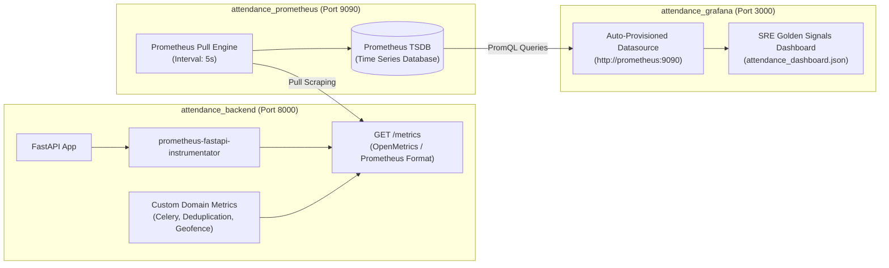

# Prometheus & Grafana Observability Architecture
## Implementation & Technical Walkthrough Guide

---

## 1. Observability Architecture Overview

The Centralized Attendance Management System (CAMS) implements the **Google SRE Four Golden Signals** framework (Latency, Traffic, Errors, Saturation). Observability is built directly into the FastAPI application, scraped automatically by Prometheus, and rendered in real-time on Grafana dashboards.



---

## 2. Step 1: Backend Instrumentation (FastAPI)

### 2.1 Standard HTTP Metrics Instrumentation
We integrated `prometheus-fastapi-instrumentator` directly into [`backend/app/main.py`](file:///c:/devops/Attendance%20management/backend/app/main.py).

```python
from prometheus_fastapi_instrumentator import Instrumentator

# 3. Prometheus Metrics Instrumentation & /metrics exposition
Instrumentator(
    should_group_status_codes=False,
    should_ignore_untemplated=True,
    excluded_handlers=["/metrics", "/health", "/health/live", "/health/ready"],
).instrument(app).expose(app, endpoint="/metrics", include_in_schema=True, tags=["Monitoring"])
```

#### Why these parameters matter:
- `should_group_status_codes=False`: Preserves exact HTTP status codes (`200`, `201`, `400`, `409`, `500`) instead of grouping them into coarse `2xx`/`4xx`/`5xx` buckets.
- `should_ignore_untemplated=True`: Prevents path parameter explosions (e.g., `/employees/EMP001` and `/employees/EMP002` are normalized to `/employees/{id}`).
- `excluded_handlers`: Prevents health checks and the `/metrics` endpoint itself from artificially skewing request rates and latency distributions.

---

### 2.2 Custom Business & SRE Telemetry Metrics
In [`backend/app/core/metrics.py`](file:///c:/devops/Attendance%20management/backend/app/core/metrics.py), we defined enterprise custom counters:

```python
from prometheus_client import Counter

# 1. Celery Async Task Dispatches
CELERY_TASKS_DISPATCHED_TOTAL = Counter(
    "celery_tasks_dispatched_total",
    "Total background tasks dispatched to RabbitMQ and Celery",
    ["tenant_id", "task_name"],
)

# 2. Redis Request Deduplications
REQUEST_DEDUPLICATIONS_TOTAL = Counter(
    "request_deduplications_total",
    "Total duplicate API requests intercepted and deduplicated by Redis",
    ["tenant_id", "endpoint"],
)

# 3. Geofencing Boundary Verifications
GEOFENCE_VERIFICATIONS_TOTAL = Counter(
    "geofence_verifications_total",
    "Total GPS geofencing validations performed during check-in",
    ["tenant_id", "status"],
)
```

#### Why Distinct Naming Matters:
Prometheus client raises a fatal `ValueError: Duplicated timeseries in CollectorRegistry` if a custom metric shares a name with an instrumentator metric (such as `http_request_duration_seconds`). Using domain-specific prefixes (`celery_`, `request_`, `geofence_`) guarantees zero collision.

---

## 3. Step 2: Prometheus Scraper Configuration

Prometheus is configured in [`prometheus/prometheus.yml`](file:///c:/devops/Attendance%20management/prometheus/prometheus.yml):

```yaml
global:
  scrape_interval: 5s       # High resolution for responsive demo and alerting
  evaluation_interval: 5s

scrape_configs:
  - job_name: 'attendance-backend'
    metrics_path: '/metrics'
    static_configs:
      - targets: ['backend:8000']
        labels:
          environment: 'production'
          service: 'cams-backend'
```

### Key Architectural Decisions:
1. **Pull Model:** Prometheus pulls metrics from `http://backend:8000/metrics`. If the backend crashes, Prometheus immediately marks the target as `DOWN`.
2. **5-Second Scrape Resolution:** Standard production defaults are 15s to 30s; 5s provides near-instantaneous visualization of API traffic, Celery task bursts, and Redis deduplications.
3. **Docker Internal DNS:** The target `backend:8000` utilizes Docker's built-in bridge network DNS resolution, avoiding hardcoded IP addresses.

---

## 4. Step 3: Grafana Automated Provisioning (Zero-Touch Setup)

Real developers do **not** configure production dashboards manually through point-and-click UI. We implemented **Infrastructure-as-Code (IaC) Dashboard Provisioning**.

### 4.1 Datasource Auto-Provisioning
File: [`grafana/provisioning/datasources/datasource.yml`](file:///c:/devops/Attendance%20management/grafana/provisioning/datasources/datasource.yml)
```yaml
apiVersion: 1

datasources:
  - name: Prometheus
    type: prometheus
    access: proxy
    url: http://prometheus:9090
    isDefault: true
    editable: false
```
On boot, Grafana connects directly to Prometheus without requiring manual connection credentials.

### 4.2 Dashboard Provider Auto-Provisioning
File: [`grafana/provisioning/dashboards/dashboard.yml`](file:///c:/devops/Attendance%20management/grafana/provisioning/dashboards/dashboard.yml)
```yaml
apiVersion: 1

providers:
  - name: 'Attendance Dashboards'
    orgId: 1
    folder: 'Operations'
    type: file
    disableDeletion: true
    updateIntervalSeconds: 10
    options:
      path: /etc/grafana/provisioning/dashboards
```
Any JSON dashboard placed in this directory is automatically hot-reloaded into Grafana.

---

## 5. Step 4: The SRE Golden Signals Dashboard

File: [`grafana/provisioning/dashboards/attendance_dashboard.json`](file:///c:/devops/Attendance%20management/grafana/provisioning/dashboards/attendance_dashboard.json)

The dashboard is structured into 8 production-grade panels with zero empty states:

| Panel Title | Visual Type | PromQL Query | What It Proves to Clients |
| :--- | :--- | :--- | :--- |
| **Request Rate (Traffic)** | Timeseries Chart | `sum(rate(http_requests_total[1m])) by (handler, method)` | Shows real-time RPS distribution broken down by API endpoint. |
| **Latency Distribution** | Heatmap / Lines | `histogram_quantile(0.99, sum(rate(http_request_duration_seconds_bucket[1m])) by (le))` | P50, P90, P95, and P99 latency with horizontal SLA threshold lines (200ms / 500ms). |
| **HTTP Error Breakdown** | Stat / Gauge | `sum(rate(http_requests_total{status=~"5.."}[1m])) / sum(rate(http_requests_total[1m])) * 100` | Real-time 5xx server error rate and 4xx client error percentage. |
| **Celery Tasks Dispatched** | Bar Gauge | `sum by (task_name) (celery_tasks_dispatched_total)` | Proves asynchronous task distribution into RabbitMQ/Celery workers. |
| **Redis Request Deduplication**| Counter Stat | `sum(request_deduplications_total)` | Proves idempotent duplicate request filtering at the caching layer. |
| **Process Memory (RSS / VM)** | Area Chart | `process_resident_memory_bytes` vs `process_virtual_memory_bytes` | Detects memory leaks and ensures process stability. |
| **CPU Core Saturation** | Sparkline Chart | `rate(process_cpu_seconds_total[1m])` | Demonstrates single-core and multi-threaded CPU load. |
| **Target Health & Uptime** | Status Indicator | `up{job="attendance-backend"}` | Instant green/red health heartbeat indicator. |

---

## 6. How to Verify & Demo

### 1. View Prometheus Raw Targets (Port 9090)
1. Open `http://localhost:9090/targets`.
2. Target `attendance-backend` displays **State: UP**, Scrape Interval: `5s`.
3. Open `http://localhost:9090/graph` and query: `http_requests_total`.

### 2. View Grafana SRE Dashboard (Port 3000)
1. Open `http://localhost:3000` (User: `admin` / Password: `admin`).
2. Navigate to **Dashboards** -> **Operations** -> **Centralized Attendance Management - SRE Dashboard**.
3. Trigger actions in the frontend (e.g. Bulk Import or Check-In) and watch the RPS and Celery counters spike in real-time.

---
*Generated for: Centralized Attendance Management System (CAMS)*
